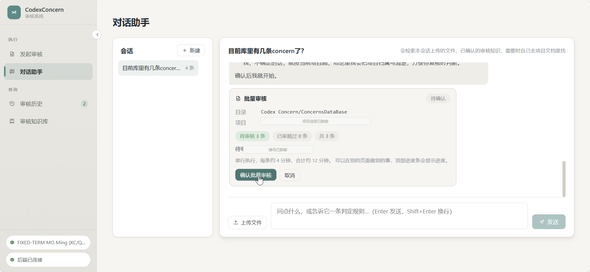
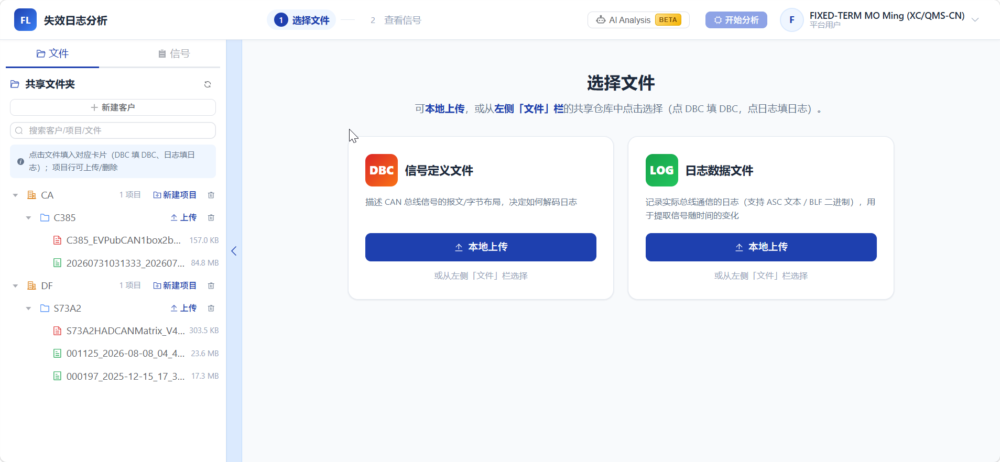
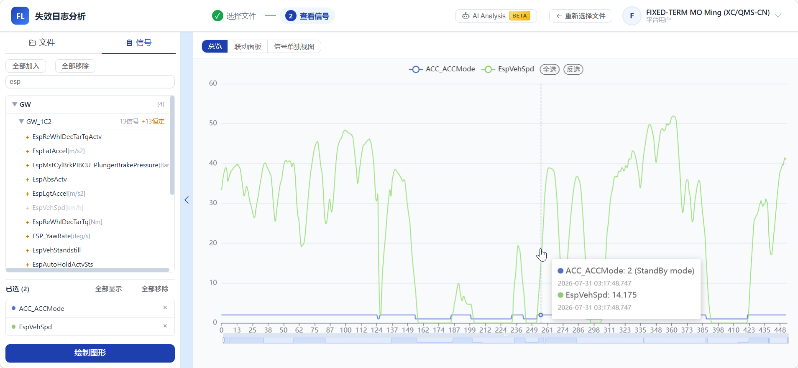
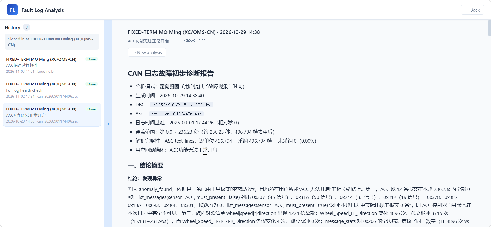
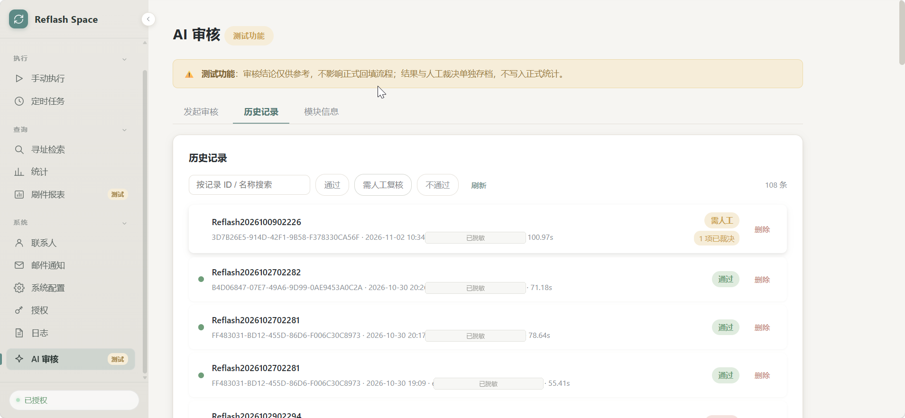
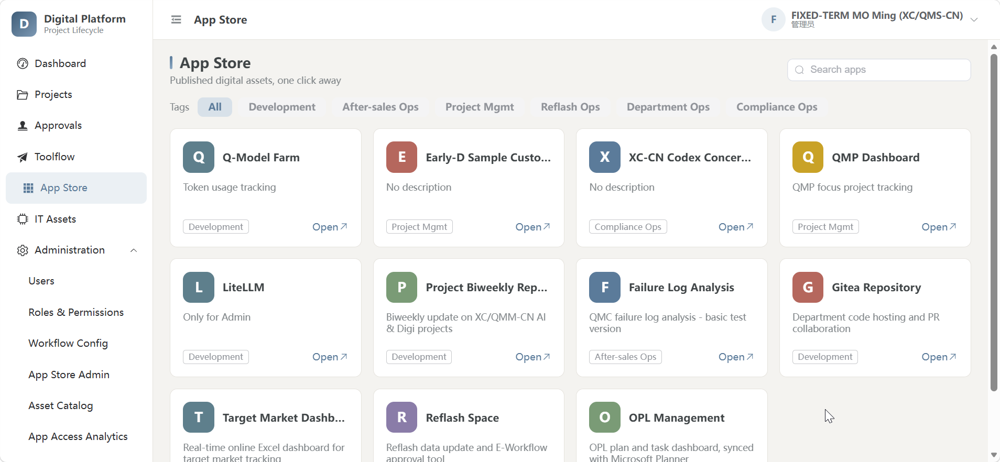
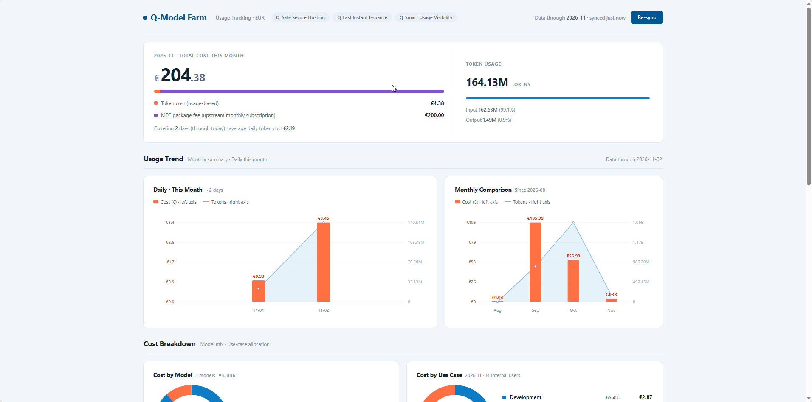
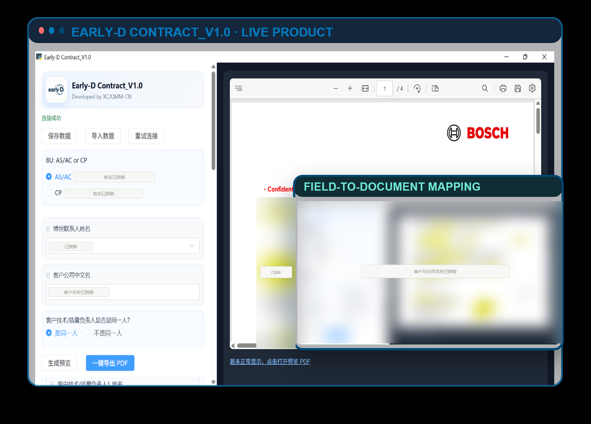

<div align="center">

# MO Ming · Bosch Algorithm Internship

**把 AI 做成工程系统，而不是 Demo**<br>
LLM Agents · RAG · Reliability Engineering · Internal Platforms

**🏆 BOSCH BBM AI DAY · 第二名（2nd Place）**  
**2026 Bosch China AI Day · Top 4 Most Impressive Topics**

[](assets/00-bosch-ai-day.jpg)

*2026 Bosch China AI Day 颁奖现场 · BBM AI Day 第二名*  
📷 图中**从右数第 2 位**（白 T 恤、戴眼镜）就是我

</div>

---

## 先认识一下

我是 **MO Ming**，在博世中国做算法实习。

这张照片拍摄于 **2026 Bosch China AI Day** 的颁奖现场。我参与的项目在 **BOSCH BBM AI DAY** 中获得 **第二名（2nd Place）**，并入选 **2026 Bosch China AI Day Top 4 Most Impressive Topics**。照片里，从右数第 2 位、穿白色 T 恤、戴眼镜的人就是我。

这段实习里，我主要在做一件事：

> **让 AI 从“会回答”，变成“能被信任地放进工程流程里”。**

我参与 / 负责的系统分别处理三类真实工作：**工程文档审核、CAN 日志诊断、刷件审批自动化**。它们有一个共同点：真正难的不是让模型生成一段话，而是让系统的**每一次失败都能被看见、被追溯、被人接住**。

> **关于这个仓库**  
> 因博世内部数据合规要求，我不能上传源代码、原始业务数据或内部文档。这里用产品界面截图记录我参与设计、开发的系统，重点展示问题定义、关键设计、工程取舍与实测结果。截图中的同事邮箱、客户名称与联系人信息已打码；涉及客户和具体项目的名称已做匿名化处理。

### 几个数字

| **3,192** | **47.7 万** | **81** | **246** |
|:---:|:---:|:---:|:---:|
| 篇文档进入检索面 | 帧 / 单份 CAN 日志 | 条生产审核裁决 | 个自动化测试 |

这些数字来自代码、commit 或实测。没有可靠人工基线的地方，我只写量级，不写“提升 N 倍”——这也是我在简历和面试里坚持的口径。

---

## 项目地图

前三个是深水区项目，后三个是同一时期参与的平台型工作。

| # | 项目 | 我的角色 | 解决的问题 |
|---|------|----------|------------|
| 01 | **CodexConcern** | 独立设计与开发 | 在 3,192 篇工程文档里判断历史 Concern 是否适用 |
| 02 | **Fault Log Analysis** | 主导后端与 AI 分析模块 | 把 CAN / CAN-FD 日志从人工逐帧比对变成分钟级诊断 |
| 03 | **Reflash Space** | 核心开发（与同事协作），主导 AI 审核模块 | 打通 Excel 与审批系统，自动巡检 + AI 复核 |
| 04 | **Digital Platform** | 参与 | 内部数字化应用的统一入口 |
| 05 | **Q-Model Farm** | 参与 | LLM 用量与成本的可视化治理 |
| 06 | **Early-D Contract Assistant** | 参与 | 合同字段到文档的自动映射与 PDF 导出 |

---

## 我最在意的一件事：静默失败

这三个项目里，最危险的 bug 都不是“报错”，而是“看起来正常”。

| 场景 | 看起来正常 | 实际发生 | 我的处理 |
|------|------------|----------|----------|
| CodexConcern | LLM 返回 HTTP 200 | `content` 为空，20/20 历史审核的检索词全为空，系统照常硬判 | 定位 `reasoning` 与 `content` 共享 `max_tokens` 的坑；修复后检索词 0 → 8 |
| Fault Log | DBC 与日志错配，帧仍能解析 | 信号数值“看着合理”，实际全错 | 数据质量预检前置 + DBC 匹配率统计 + 错配检测 |
| Reflash Space | 详情接口失败，行被标红 | 全表误标红，业务方被误伤 | “取不到详情 = 无法判定” → 跳过、不标红，下轮重试 |
| Reflash AI | 大写 `FAIL` 没有命中分支 | 整张审核表被静默判为通过 | `status` 归一化 + 降级可见性设计 |

后来我做所有系统的默认姿势都是：**先设计失败路径，再设计成功路径。**

---

## 01 · CodexConcern

### 找不到 ≠ 不存在

**独立设计与开发** · `Python` · `FastAPI` · `Vue 3` · `OpenAI Agents SDK`

[](assets/02-codexconcern.png)

*批量审核：先预览待审条目、跳过数量与预计耗时，再确认执行*

**业务问题：** 一个 ADAS 雷达项目会不断收到历史平台的 Codex Concern——类似“问题预警单”。项目方必须回答：这个机制在我们项目里存不存在？参数是多少？如果不适用，依据是什么？

人工判断一条 concern，通常要翻 5 类文档：功能定义（TCD）、机制实现（SW Design / Docupedia）、参数标定（CDM / 需求表）、测试用例、失效后果（T&R / FMEA）。更麻烦的是术语不一致：

- concern 写 `debouncing`，项目文档写 `low-pass filter`；
- concern 写 `Loose Radar`，TCD 写 `Heavy misalignment`。

按字面搜索，结果往往是 0 命中。但“没搜到”不等于“不存在”。

### 我的设计：机械步骤用代码，理解步骤用 LLM

```text
策略加载 → Concern 结构化 → T&R 检索 → Agent 找机制锚点 → 参数补齐 → 裁决
  代码          LLM            代码          Agent ≤10 轮         代码三态      LLM
```

四个关键设计：

- **Agent 自主检索，替代固定词表**：把 concern 全文交给 agent，节点 1 的检索词只作“起点提示”。Agent 自己决定换什么词、搜哪个目录、读哪一段；每轮工具返回第一行都是剩余预算，最多 10 轮。
- **锚点逐字核对**：Agent 引用的原文必须能在它声明的文件里规范化整段包含，否则按行 ≥80% 命中；过不了就告警。这条抓的是“编造引用”——模型可以对“找没找到”含混，但引用必须对得上原文。
- **检索面补全，而不是换排序算法**：旧方案只索引 `_md` 目录的 1,458 篇；公盘上还有 1,052 个原始文件从未进入检索面。补全到 3,192 篇后，某 concern 的 `debounce` 命中从 1 篇提升到 32 篇，`adhesive` 从 1 篇误命中变成 6 篇真实命中。换任何检索算法都救不回这个缺口。
- **检索三态**：`FOUND / NO_HIT / ERROR`。工具故障必须单独成档，节点 5 的 prompt 里明写“检索失败，未验证”。早期版本把 `ERROR` 写成“未找到”，等于把工具故障说成数据缺口。

<details>
<summary><b>工程细节：为什么 Agent 接入层要自己写</b></summary>

- **Tracing 必须关掉**：SDK 默认会把 prompt、工具输入输出、模型回复导出到外部 tracing 端点。这里传的是内部文档片段，外发等于泄露。实现上在 `import agents` 之前设 `OPENAI_AGENTS_DISABLE_TRACING=true`，import 后再调 `set_tracing_disabled(True)` 兜一层。
- **不能用 `asyncio.run()`**：`AsyncOpenAI` 的连接池绑在创建它的循环上。每次 `asyncio.run()` 新建并关闭循环，第二次审核直接 `Event loop is closed`，而业务方只看到“审核失败”。改成常驻 daemon 线程 + `run_coroutine_threadsafe`。
- **自签证书 + 代理**：容器出网走宿主代理，网关给的是自签证书链。`httpx` 默认按 `certifi` 校验，报的是 `APIConnectionError`，看起来像网络不通，实际是 TLS 握手失败；同一容器里 `requests(verify=False)` 却能返回 200。

</details>

### 另一个关键决定：并发不是快，是错

`run_review` 开头会修改模块级的全局项目状态。两个审核并发跑不同项目，会出现 A 的检索器拿着 B 的语料搜索，结论照常落库，留档里看不出任何异常。

所以所有审核共用**一条串行 worker + 优先级队列**。单条审核最多插队晚 1 秒，但不会互相污染。

### 实测结果

| 指标 | 结果 |
|------|------|
| 生产留档裁决 | 81 条（适用 34 / 不适用 46） |
| 单条审核耗时 | 约 4 分钟无人值守（自主检索 90–110s / 补参数 66–230s / 裁决 26–70s） |
| 批量审核 | 一次 80 条，后台串行跑完，自动跳过已审 |
| 检索面 | 1,458 → 3,192 篇 |
| 语料规模 | 3,192 篇 / 284 MB，打包后秒级加载（逐文件读约 47 秒） |
| 代码规模 | 13,958 行 Python + 4,577 行 Vue |

> **最危险的一次 bug**：20/20 历史审核的检索词全为空。模型把 `max_tokens` 全烧在 reasoning 上，`content` 是空字符串，HTTP 却是 200，系统全程“看起来正常”地硬判。修复后节点 1 检索词从 0 变成 8 个。<br>
> **最危险的不是报错，是 HTTP 200 的正常空转。**

`RAG` · `Agentic Retrieval` · `Verbatim Citation Check` · `Policy Versioning` · `Serial Queue`

---

## 02 · Fault Log Analysis

### LLM 只做选择题，不做算术题

**主导后端与 AI 分析模块** · `Python` · `FastAPI` · `LangGraph` · `Vue 3` · `Docker`

[](assets/03-failure-log-analysis.png)

*文件配对：DBC 信号定义 + ASC / BLF 日志*

[](assets/03b-failure-log-signals.png)

*信号视图：多信号叠加、时间轴缩放，以及联动面板 / 单独视图*

[](assets/03c-failure-log-ai-report.png)

*AI 诊断报告：结论摘要、解析范围与支持结论的报文证据*

**业务问题：** ADAS 整车在路测 / 售后阶段出现功能异常时，工程师需要从 CAN / CAN-FD 总线日志中定位问题。典型的一份日志有 **47.7 万帧 / 453 秒 / 76 个报文 ID**，用 Vector CANalyzer 逐条比对是小时级工作，而且高度依赖工程师经验。

这个平台把流程产品化：上传 DBC + 日志，自动完成报文解析、信号解码、异常定位，最后由 LLM 结合确定性工具给出的证据，输出一份可审计的中文故障诊断报告。

### 硬约束：宿主在生产，引擎必须独立

| 约束 | 对我的要求 |
|------|------------|
| 宿主侧只加文件、不改现有文件 | `can_analysis.py` / `logreader.py` / `sensor_profiler.py` / `db.py` 一行不能改，`requirements.txt` 一个字不能加 |
| 依赖版本冲突 | 宿主锁 `cantools==42.0.3`，引擎需要 `44.1.0`（跨大版本） |
| 静默错误是最大敌人 | 字段名写错、DBC 错配、解析丢帧都不报错，只是结果变错 |
| 28 道回归门 | 改 `engine/` 任何一行都必须全量回归 |

<details>
<summary><b>工程细节：为什么引擎必须跑独立容器</b></summary>

1. **依赖冲突不可调和**：同进程意味着要么升级宿主（可能改变既有解析结果），要么降级引擎（28 道门作废）。
2. **`sys.path` 同名模块会静默串味**：引擎里的 `can_analysis` / `sensor_profiler` 是顶层绝对导入。实测两种 `sys.path` 顺序，宿主版本会赢；而宿主那份的调用面恰好齐全，不会报错——引擎会用宿主的解析层默默跑完，产出一份“看起来完全正常”的错误报告。
3. **内存峰值相加会 OOM**：引擎 LogStore 上限 1.5 GB，宿主宽表峰值 2 GB；独立容器各管各的，引擎 OOM 不拖垮宿主。

附带一条安全设计：引擎的 `/v1/*` 无鉴权且接受任意服务端路径，所以 compose 刻意不给它绑 ports，鉴权收口全部留在宿主侧，引擎只在内部网络可达。

</details>

### AI 引擎：8 节点状态机 + 双重熔断

```text
ingest → quality_precheck → parse_issue → plan → execute → assess → diagnose → report
                                              ↑________|
                                          证据不足时回到规划节点
```

- **双熔断**：① 轮数上限（默认 3）；② 本轮无任何新证据（工具全失败或返回空）→ 立即收敛。两道熔断在 `assess` 内部把 `sufficient` 压成 `True`，判断只写一处，避免“路由说要补查、评估说已收敛”的自相矛盾。
- **必答事实强制补查**：确定性代码产出的关键事实（如“同族信号中某成员出现 25 次孤立脉冲，其余成员 0 次”）尚未被回应时，会把 `sufficient` 压回 `False` 并写入 `next_focus`。
- **11 个确定性工具**：所有时间、帧数、信号值、跳变时刻只能来自工具；工具名用 `Literal` 类型钉死，模型在结构上无法发明工具名；信号名只能从确定性召回的候选集里选，LLM 只能在候选内做语义排序。
- **两层归因**：允许“异常信号 → 用户所述现象”（第一层，必须做），禁止“异常信号 → 物理根因”（第二层，如“传感器坏了”，无证据支撑）。早期模型曾把一个 NM 报文的常态间歇发送写成“控制器复位导致报文丢失（置信度 0.65）”——凭空造故障，比漏报更严重。

### 可信度：把“数据质量问题”前置

- **质量预检前置**：某数据集帧级 DBC 匹配率只有 **60.0%**（286,604 / 477,735），有 9.5% 的帧在 DBC 里完全没有定义。不前置查清，agent 会得到空结果并误判为“信号正常”。
- **DBC 错配检测**：DBC 与日志不配对时，帧照常解析、信号照常解出，只是数值“看着合理、实际错误”。用 4 份 ASC × 3 份 DBC = 12 组配对矩阵验证判据。
- **族内自对照**：真实故障常表现为同族成员间的相对差异。实测四个轮速方向信号中，FR 变化 54 次，其余三轮各 2 次——逐信号看四个都“有变化、都合理”，只有放在一起才浮出异常。

### 性能：把“不可接受”的解析开销拆掉

| 指标 | 改造前 | 改造后 |
|------|--------|--------|
| 85 MB / 47.7 万帧日志解析 | 26 s + 2 GB 常驻，并发 2 请求即 OOM | 缓存命中 0.2 s，内存降至几十 MB |
| 全量信号解码 | 12 s / 1.2 GB | 按报文惰性解码，单报文通常几十毫秒 |
| 一次完整分析 | — | 约 1 分钟 |

关键做法：解析结果存 numpy 紧凑数组 + payload 列表；落盘缓存 key = 路径 + mtime + size + 解析器版本；不再物化 456 列全量宽表，agent 问到哪个报文才解哪个。

> **回归门全绿 ≠ 没回归**：有一次把 LLM 的 thinking 打开后，推理 token 从 0 涨到 20,875，单次分析 7.55 s → 37.9 s、整体 60 s → 304 s，而 28 道回归门全绿——没有一门在看这件事。最终把 thinking 默认关闭，并补了一道门钉住它。

### 规模与工程纪律

- 约 **1.4 万行 Python**（宿主 3,150 + 引擎 10,929）、**4,700+ 行 Vue / JS**；
- **28 道脚本式回归门**，每道都做过反向对照：把修复回退，断言必须 FAIL；
- 宿主侧 10 个单测模块 + 前端 **204 个 Vitest 用例**；
- 三容器 Docker Compose + nginx 网关 + SSO 身份注入 + Infisical 密钥管理。

`LangGraph` · `CAN / CAN-FD` · `DBC` · `Deterministic Tools` · `Evidence-bound Diagnosis`

---

## 03 · Reflash Space

### 会写生产 Excel 的系统，第一原则是“宁可不动，不可写错”

**核心开发（与同事协作）· 主导 AI 审核模块的工程化与可靠性**<br>
`FastAPI` · `Vue 3` · `Microsoft Graph` · `SQLite` · `Docker` · `LLM`

[](assets/05-reflash-space.png)

*发起审核：输入 E-Workflow 记录 ID 或完整链接，结果页展示通过 / 需人工介入 / 不通过 / 冲突*

[](assets/05b-reflash-audit-history.png)

*历史记录：每次审核的结论、耗时、人工裁决与删除入口*

**业务问题：** 客户或博世侧改了软件版本后，需要把一批 ECU 产品重新刷写，并登记在 E-Workflow 审批系统中。执行清单在 SharePoint 在线 Excel，审批记录在 E-Workflow，两边没有关联字段，只能靠料号人工对齐。

- 全量记录 **1,440 条**，其中 **225 条是未提交草稿**，有效记录 1,215 条；
- 每张表几十到上百行，每次巡检都要全量重查；
- 审核涉及 CoverSheet 版本比对、DROP 料号状态、外箱 / 产品标签、XFLASH 工具包结构、禁止注释关键配置等 **5 大类 20+ 检查点**；
- 各基地数据分散，人工判断口径不一致，结果也没有留痕。

这个系统在不改变 E-Workflow / SharePoint 的前提下，做了一个中间层自动化工具：定时拉取审批记录，按料号匹配，自动回填版本号并标色（绿 = 已完成 / 黄 = 进行中 / 红 = 无有效记录）；结果可追溯、可告警、可部署在内网。

### 防御性工程：因为写的是生产 Excel

| 风险 | 处理 |
|------|------|
| 模板解析失败 → 字典为空 → 全表误标红 | 寻址字典构建失败直接中止整轮，不执行任何写操作；“返回 0 条”也视为失败，30s / 60s 退避重试 3 次后抛错 |
| 详情拉取失败被误判为“无记录” | 严格区分：取不到详情 = 无法判定 → 跳过该行、不标红，等下轮重试；记录存在但被过滤 → 才标红 |
| 429 / 5xx 瞬态错误 | 最多 4 次指数退避，尊重 `Retry-After` |
| 手动执行与定时执行并发写同一份 Excel | 共用一把 `_run_lock` 互斥锁，重入直接跳过 |
| “值写入了但红色残留”的半修复状态 | 绿行先 `clear_row_color` 再写单元格 |

为了把 API 调用从“行数 × 全量”降下来，系统整轮只构建一次内存倒排索引 `pn_to_ids`（料号 → 记录 ID 列表），所有 Sheet 共享；随后每行只需按命中的少量 ID 拉详情。调用量从 `行数 × 全量` 降到 `1 × 全量 + 命中数`。

### AI 审核：脚本规则 + LLM 双保险

```text
fetch → plant → script → ai → merge → render
抓取     厂归属    确定性审核   独立复核   冲突仲裁    审核树
```

- 覆盖 **5 大步骤 / 21 个节点 / 16 个叶子检查项**；
- 脚本层做确定性检查（PDF 文本提取、XFLASH 工具包结构、`CHECK_FBL_Version` 是否被注释）；
- LLM 层对同一批节点**独立复核**，提示词明确要求“不要盲从脚本结论”；
- 只有 pass / fail 相反才标 `conflict` 交人工；`warn` 被 AI 改成明确结论则采纳 AI；`skip` 不参与 AI；
- 重复 id 一律作废，回落脚本判定并记入 anomalies 留痕。

<details>
<summary><b>工程细节：AI 输出的四层防护</b></summary>

1. **JSON 容错**：兼容 markdown 代码块、前后夹杂说明文字；修复 AI 在 reason 里写 Windows 反斜杠路径（如 `C:\...`）产生的非法 JSON 转义，合法的 `\t` / `"` / `\uXXXX` 原样保留。
2. **Pydantic 结构校验**：单条不合规只丢该条，其余照常；整包不合规或一条裁决都没给 → 整案降级为仅脚本。
3. **状态归一化**：修掉“大写 `FAIL` 既不入 fail 分支、也不入 warn 分支，整张表被判为 pass”的静默失误；id 数字转字符串；非法 confidence 降级为 `low`。
4. **降级必须可见**：`ai_status` 区分 `ok / failed / disabled`；AI 失败时注入一条合成 `warn` 节点，让“AI 层未生效”直接体现在总体判定上，必须经人工裁决，而不是静默放行。

</details>

**性能优化：** 经 LiteLLM 网关调 DeepSeek-V4-Flash 时，网关默认开启 thinking。这个场景是“按规则逐条比对”，不需要长链推理。关闭后：

| 指标 | 优化前 | 优化后 |
|------|--------|--------|
| 单案耗时 | 30–90 s | 8–17 s（4–6 倍） |
| completion tokens | 10,000–17,000 | 约 2,000 |
| reasoning tokens | 8,000–15,000 | 0 |
| 裁决条数 | 15–16 条 | 15–16 条（质量不变） |

**人工裁决体系：** SQLite WAL 三表建模——`reviews`（审核快照）/ `decisions`（当前裁决）/ `decision_log`（变更流水）。二次审核时计算表单内容指纹，指纹一致则复用上次结果并继承已做过的裁决，审核员不用把每个黄节点重新点一遍。

### 结果

| 指标 | 结果 |
|------|------|
| 数据规模 | 1,440 条全量 / 1,215 条有效 |
| AI 审核耗时 | 30–90 s → 8–17 s（4–6 倍），裁决质量不变 |
| 审核覆盖 | 5 大步骤 / 21 个节点 / 16 个叶子检查项 |
| API 与页面 | 55 个路由端点 / 12 个功能页 |
| 测试 | 246 个用例 / 18 个文件，网络层全 mock |
| 代码规模 | 约 2.5 万行（后端 + 前端 + AI 子项目，不含 vendor） |
| 运行方式 | 每小时巡检，7×24 定时，人只处理红 / 黄异常项 |

> **AI 不是替代人，而是把人从 21 个节点的初筛里解放出来，只处理黄和冲突。**

`Human-in-the-loop` · `Double-check Arbitration` · `Visible Degradation` · `Content Fingerprint Reuse` · `Defensive Writes`

---

## 支撑系统

### 04 · Digital Platform

**参与** · 内部数字化应用的统一入口

[](assets/01-digital-platform.png)

从界面可见的能力：App Store 式应用目录、标签分类与搜索、审批入口、角色与权限、IT 资产目录、应用访问分析。它把分散的内部工具收进一个可发现、可申请、可复用的入口；本仓库只展示产品化界面，不展开内部实现。

### 05 · Q-Model Farm

**参与** · 让大模型用量和成本变得可见

[](assets/04-q-model-farm.png)

基于 LiteLLM 网关的用量追踪：按天 / 月查看成本与 Token 变化，按模型和用例拆解成本，并提供 Q-Safe 安全托管、Q-Fast 即时开通、Q-Smart 用量可见三项服务能力。界面中的数值仅作展示。

### 06 · Early-D Contract Assistant

**参与** · 把合同填写变成“字段到文档”的自动映射

[](assets/06-earlyd-contract.png)

*界面中的客户与联系人信息已脱敏*

把 BU、博世联系人、客户公司、技术 / 质量负责人等字段做成结构化表单，映射到合同模板对应位置，生成预览并一键导出 PDF；支持保存 / 导入数据与重试连接。它把“找模板、填字段、反复核对”的文书工作变成一条可复用的自动化流程。

---

## 我反复练习的几件事

### 1. 先设计失败路径，再设计成功路径

三个项目里最危险的 bug 都不是崩溃，而是“看起来正常”：空 content、错配的 DBC、失败后被标红的 Excel、没被识别的大写 FAIL。系统的可信度，取决于失败时它说不说真话。

### 2. 把确定性交给代码，把语义判断留给模型

CodexConcern 的流水线按“机械 vs 理解”分工；Fault Log 的所有数值来自 11 个确定性工具；Reflash 的脚本层先把老师傅的经验固化成规则。LLM 适合做选择题和解释题，不适合做算术题。

### 3. 降级必须可见

AI 失败、路径不可达、扫描件读不出、工具包缺失——这些场景不能“假装通过”。要么显式标黄交人工，要么在结论上注入告警节点，让“AI 层没生效”成为一个人能看见、能裁决的状态。

### 4. 人工兜底不是保守，是上线前提

AI 预审 + 人工终审、单独存档、不写入正式统计、审核留痕与指纹复用——这些设计看起来“慢”，但它们让系统敢被真实业务使用。

---

## 技术栈

| 方向 | 技术 |
|------|------|
| **LLM / Agent** | OpenAI Agents SDK、LangGraph、LiteLLM 网关、RAG、结构化输出、引用校验、tracing 控制 |
| **后端** | Python 3.11、FastAPI、Uvicorn、Pydantic v2、PostgreSQL 16、SQLite WAL |
| **前端** | Vue 3、Vite、Element Plus、ECharts |
| **数据与集成** | Microsoft Graph、E-Workflow REST、SMB / DFS、PyMuPDF、cantools / python-can、openpyxl |
| **基础设施** | Docker Compose、nginx、SSO 网关、Infisical、CIFS 只读挂载 |
| **质量** | 28 道回归门（含反向对照）、246 个单元测试、204 个前端 Vitest 用例 |

---

## 数字口径

文中数字来自代码、commit 或实测。人工基线没有正式计时的地方，我只写量级，不写倍数：

> 例如故障日志项目，我会写“人工逐条比对通常以小时计；系统从上传到拿到报告是分钟级”，而不是“效率提升 10 倍”。

这既是对读者负责，也是对我自己负责——面试官追问口径时，我能把每个数字的来源讲清楚。

---

## English Snapshot

I'm **MO Ming**, an algorithm intern at **Bosch China**. I build internal AI systems where reliability matters as much as model quality.

At **BOSCH BBM AI Day**, my project won **2nd Place** and was selected among the **Top 4 Most Impressive Topics** at the 2026 Bosch China AI Day.

**Selected work:**

- **CodexConcern** — an agentic document-audit system that decides whether historical engineering concerns apply to a new ADAS radar project. It indexes 3,192 documents, uses a 5-node pipeline with an autonomous retrieval agent, verifies quoted evidence verbatim, and has produced 81 archived decisions at ~4 minutes per audit.
- **Fault Log Analysis** — a CAN / CAN-FD fault-diagnosis platform. It parses DBC + ASC/BLF logs (477k frames per typical log), runs an 8-node LangGraph pipeline with deterministic evidence tools, and keeps all numbers out of the LLM. The engine runs in an isolated container to avoid dependency and `sys.path` collisions with the production host.
- **Reflash Space** — a reflash-audit automation platform integrating SharePoint Excel and E-Workflow. It supports hourly reconciliation, defensive production writes, a script + LLM double-check audit pipeline (5 steps / 21 nodes / 16 leaf checks), visible degradation, and human decision reuse. The AI audit path is 4–6× faster after disabling unnecessary model thinking.

> Due to Bosch data-compliance requirements, no source code, customer data, or internal documents are included. Customer / project names and colleague contact details in the screenshots have been anonymized or redacted. The views expressed here are my own and do not represent Bosch.

---

## 说明 / Disclaimer

- 本仓库是**个人作品集**，不是博世官方仓库；文中观点仅代表个人。
- 不包含博世源代码、内部文档或客户数据文件；截图只展示产品界面与交互。
- 截图仅用于展示产品界面与个人参与的工作；部分功能处于 Beta / 测试阶段。
- 截图中的同事邮箱、客户名称与联系人信息已做打码 / 模糊处理；客户与具体项目名称已匿名化。如仍有不应公开的信息，请通过 GitHub 联系我，我会尽快调整或撤下。
- “Bosch” 名称及相关商标归 Robert Bosch GmbH 所有。

<div align="center">

**Thanks for reading.**  
[GitHub @Moming0215](https://github.com/Moming0215)

</div>
